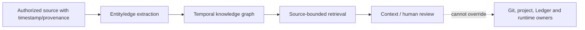

# Fork qualification notes — temporal knowledge graphs

**Scope:** public Graphiti research reference. Graphiti models temporally qualified relationships; a graph index is not canonical task or runtime state.

Qualification should preserve event time vs ingest time, original source IDs, contradictions/supersession, opt-out and deletion semantics, visibility, bounded traversal cost and negative private-data retrieval tests. Historical user chats may be represented as attributed edges but do not become live account memory or deployment receipts.

Do not publish personal archive nodes, credentials, non-public topology or identity graphs. Retain upstream Apache-2.0 notices and exact source version. A local query pass is not proof of completeness across missing ChatGPT exports.
